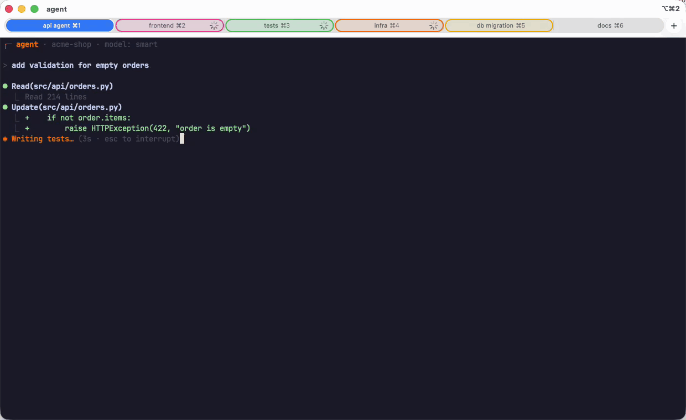

# Tabspace

**Mission Control for iTerm2 tabs, inside a tab.** Press **⌘⌥O** and a dedicated
**Tabspace** tab shows every other tab as a live, colored preview, including each
tab's split-pane layout. Watch all your AI agents at once; click a preview to jump
to that tab (or straight to the clicked pane).



* Your tabs, panes and running programs are untouched: no merging into splits, no tmux.
* Previews are **read-only**. Clicking only switches tabs and never sends input to an agent.
* Tiles get a **green border** while their output is changing (busy) and grey when idle.
* Opening, closing, renaming and reordering tabs is picked up automatically (within ~1 s).
* Tabs from all iTerm2 windows are shown (labelled `W1`, `W2`, … when you have several).
* Pressing the shortcut again reuses the same Tabspace tab. Press it *on* the Tabspace tab
  to go back to where you were.

## Requirements

* macOS with [iTerm2](https://iterm2.com) **3.5 or newer** (tested on 3.7.7).
* iTerm2's Python API (the installer offers to enable it).
* No other dependencies. Tabspace is a single Python file that uses iTerm2's own
  Python runtime (iTerm2 downloads it once, on first use).

## Install

**From a clone or the release zip:**

```sh
git clone https://github.com/tomasrasymas/iterm2-tabspace.git   # or unzip tabspace-<version>.zip
cd iterm2-tabspace
./install.sh
```

**One-liner** (after the repo is published):

```sh
curl -fsSL https://raw.githubusercontent.com/tomasrasymas/iterm2-tabspace/main/install.sh | bash
```

The installer:

1. checks your iTerm2 version,
2. copies `tabspace.py` to `~/Library/Application Support/iTerm2/Scripts/AutoLaunch/`
   (so it starts with iTerm2),
3. creates `~/.config/tabspace/config.json` (an existing one is kept),
4. asks before turning on iTerm2's Python API, and
5. starts Tabspace immediately, with no iTerm2 restart.

**One-time prompts on first install** (from iTerm2 itself, not Tabspace):

* If the Python API was off and iTerm2 is running, open **iTerm2 → Settings → General →
  Magic**, untick and re-tick **Enable Python API** (iTerm2 only starts the API when you
  confirm it there, or after a restart). Then choose **Scripts → AutoLaunch → tabspace.py**.
* iTerm2 offers to **download its Python runtime** the first time any script runs.
  Click OK/Download.

Re-running `./install.sh` upgrades in place; open Tabspace tabs reconnect on their own.

## Use

| Action | Result |
|---|---|
| **⌘⌥O** | Open the Tabspace tab, or switch to it if it exists |
| **⌘⌥O** while on the Tabspace tab | Go back to the tab you came from |
| Click a pane in a preview | Switch to that tab and focus that pane |
| Click a tile's border/title | Switch to that tab |
| **1**–**9** | Switch to tile *n* |
| **q** | Close the Tabspace tab |

Each pane preview shows its **latest lines** (bottom of the screen / where the cursor is),
cropped to fit, at your normal font size so it stays readable.

## Change the shortcut

Edit `~/.config/tabspace/config.json`:

```json
{
  "shortcut": "cmd+opt+o",
  "refresh_seconds": 1.0,
  "activity_seconds": 5.0
}
```

* `shortcut`: modifiers `cmd`, `opt`/`alt`, `ctrl`, `shift` plus a letter, digit or
  `f1`–`f20`, e.g. `"ctrl+opt+space"`, `"cmd+shift+f2"`.
* `refresh_seconds`: how often previews refresh while the Tabspace tab is visible (min 0.25).
* `activity_seconds`: how long a tile stays green after its output changes.

Then restart Tabspace: re-run `./install.sh`, or use **Scripts → Manage → Console**,
terminate `tabspace.py`, and start it again from **Scripts → AutoLaunch**.

**Prefer iTerm2's own key binding?** Set `"shortcut": null`, then in **Settings → Keys →
Key Bindings** click **+**, press your key, choose action **Invoke Script Function**
and enter `tabspace_toggle()`.

## Uninstall

```sh
./uninstall.sh
# or: curl -fsSL https://raw.githubusercontent.com/tomasrasymas/iterm2-tabspace/main/uninstall.sh | bash
```

This closes Tabspace tabs, stops the service, and removes the script and
`~/.config/tabspace`. Your other tabs and running programs are not touched. It does not
turn off the Python API (other scripts may need it). If you added a key binding
yourself, remove it in Settings → Keys.

## How it works and its limits

Tabspace is an iTerm2 [Python API](https://iterm2.com/python-api/) AutoLaunch script with two roles:

* **Service.** It runs in the background inside iTerm2's script runtime and tracks
  windows, tabs and split layouts. While an Tabspace tab is visible, it reads each
  pane's screen contents (text plus colors and attributes) about once a second and
  renders the grid. When no Tabspace tab is visible it reads nothing, so idle CPU is about 0%.
* **Viewer.** The Tabspace tab runs `tabspace.py --viewer`, a tiny client that only
  draws frames and reports clicks and keys to the service over a private Unix socket
  (mode 0600).

Read-only by design. The service only calls API methods that *read* sessions, plus
"activate tab/pane" for navigation and "close" for the Tabspace tab itself. It never
sends text, resizes, or restarts anything. The integration test runs fake agents that
log any byte of input they receive, and checks that the log stays empty.

**Limitations (iTerm2 API):**

* **Previews are rebuilt from text, not pixel thumbnails.** iTerm2 3.7 can screenshot
  a pane (`Session.async_screenshot`), but scaled down to a tile those images are
  unreadable, and the Tabspace tab can't crop them without extra dependencies. Rebuilt
  text keeps the latest lines readable. Images and inline graphics in panes aren't shown.
* **Not a web page.** iTerm2's built-in browser needs a separate Browser Plugin
  download, which would make installing harder, so Tabspace draws in a normal terminal tab.
* **The built-in shortcut only works while iTerm2 is the active app.** It's an iTerm2
  key filter, not a system-wide macOS hotkey. To catch the shortcut, the service sees
  iTerm2 key events; it compares them with the shortcut and discards them, and never
  stores or logs them. Use `"shortcut": null` and an iTerm2 key binding if you prefer.
* Emoji and other wide characters are measured with Unicode width tables. A rare
  character may be off by one column in a preview.
* Changes appear within `refresh_seconds` (1 s by default).

## Troubleshooting

* **The Tabspace tab says "Waiting for the Tabspace service…"**: the service isn't running.
  Use **Scripts → AutoLaunch → tabspace.py**, or check that the Python API is enabled.
* **⌘⌥O does nothing**: look in **Scripts → Manage → Console → tabspace.py** for
  `Shortcut … active` or an error. Another app may own the shortcut; pick a different one.
* **iTerm2 asks to allow a connection**: allow it. iTerm2 asks once per script.

## Development

```sh
make test          # unit tests (no iTerm2 needed)
make integration   # live test: opens a throwaway iTerm2 window with fake agents and closes it
make dist          # builds dist/tabspace-<version>.zip for sharing
```

The integration test needs the `iterm2` package (`pip install iterm2`) and a running
Tabspace service. It only creates and closes its own window. Note: key `1` etc. and
clicks are tested through a simulated viewer; the real ⌘⌥O keypress needs a human.

## License

MIT
